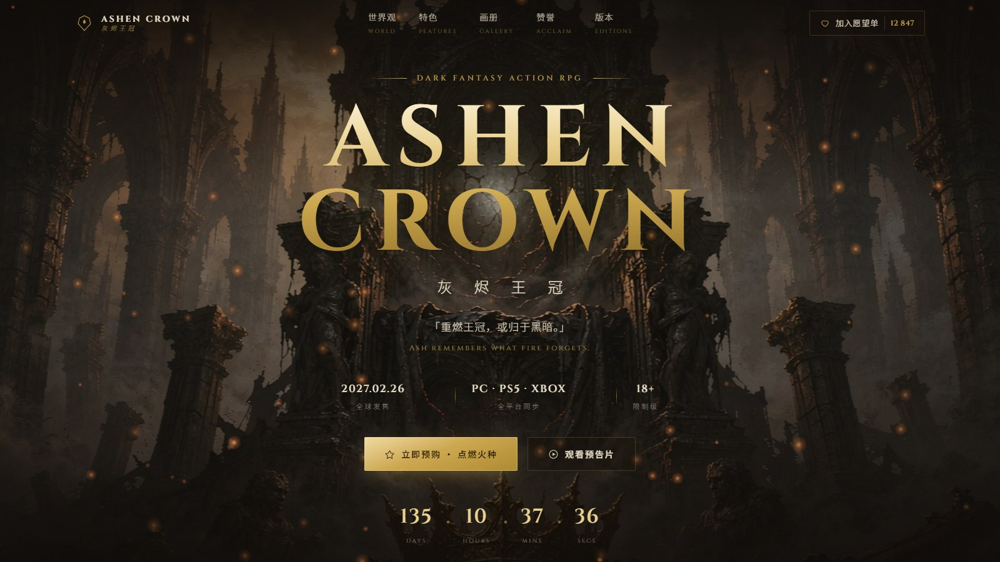

<p align="center">
  
</p>

<h1 align="center">ASHEN CROWN · 灰烬王冠</h1>

<p align="center">
  <b>虚构独立游戏官方发售页 · 暗黑奇幻 / 油画质感 / 鎏金描边</b><br/>
  <i>Dark fantasy action RPG release page — oil painting texture, gold rim light, ember orange.</i>
</p>

<p align="center">
  
  
  
  
  
</p>

**在线预览：<https://hulinkang9527.github.io/ashen-crown/>**（GitHub Pages，分支部署）

---

## 这是什么

一个**虚构**独立游戏的官方发售页设计稿，可以直接用浏览器打开（零构建、零依赖）。
整页以「深炭黑底 + 鎏金描边 + 余烬橙点缀」为骨架，主视觉走**油画质感 + 电影感逆光**，
调性参考《艾尔登法环》《黑暗之魂》的厚重史诗感；**没有霓虹故障、没有明亮卡通**。

> 世界观：火之纪元已熄。最后一枚火种在旧王崩落之夜碎裂，灰烬覆盖七座圣城。
> 你是「灰之徒」——重燃王冠，或归于黑暗。

## 直接看

| 方式 | 做法 |
|---|---|
| 本地 | 双击 `index.html` 即可（图片为相对路径，无需服务器） |
| 本地服务 | `python -m http.server 8080`，访问 <http://127.0.0.1:8080> |
| 在线 | 开启仓库 Settings → Pages（Source: `main` / `root`） |

## 页面结构（7 屏）

| # | 区块 | 要点 |
|---|---|---|
| 1 | **透明导航 + 愿望单** | 滚动后毛玻璃吸顶；愿望单按钮带计数与心跳动效；移动端抽屉菜单 |
| 2 | **Hero 全屏主视觉** | 油画大图 + 双重渐变压暗 + 巨字 Cinzel 鎏金渐变标题 + 中文副名 + slogan + 发售日期/平台/分级 + 购买/预告双 CTA + 发售倒计时 + 余烬粒子 |
| 3 | **世界观** | 左文右图，鎏金描边画框与四角装饰，引言块 + 数据 chips |
| 4 | **四大特色** | 开放世界 / 魂系战斗 / 碎片叙事 / 联机共战，手写 SVG 线性图标 + 序号水印 + 悬停余烬辉光 |
| 5 | **画面展廊** | 1 张通栏 + 2 张并列，鎏金画框，点击开灯箱（Esc 关闭） |
| 6 | **媒体赞誉** | 评分巨字（9.6 / 9.5 / 10 / 38）+ 五星 + 引语 + 来源（内容为虚构演示） |
| 7 | **三档版本购买** | 灰之徒版 ¥198 / **豪华版 ¥298（鎏金高亮 + 「最受欢迎」角标）** / 典藏版 ¥688 |
| — | **页脚** | 开发商 / 页面导航 / 社交 SVG 图标 / **18+ 限制级** 分级 / 虚构声明 |

外加贯穿全篇的**鎏金分割线**（渐变细线 + 发光菱形）与移动端适配。

## 素材

### AI 生成主视觉（4 张，1920×962，统一 16:9 画幅）

| 文件 | 用途 |
|---|---|
| `assets/img/hero-throne.jpg` | Hero 主视觉 · 无顶圣殿中的灰烬王座与远立其下的灰之徒 |
| `assets/img/world-ashfield.jpg` | 世界观插画 · 灰之徒立于余烬荒原 |
| `assets/img/battle-ashknight.jpg` | 展廊 · 与灰烬骑士在坍塌圣堂交锋 |
| `assets/img/sanctum-dome.jpg` | 展廊 · 半沉黑水的鎏金穹顶圣所 |

统一 prompt 风格锚（英文，强调 dark fantasy / oil painting texture / cinematic lighting / gold rim light / no text），
原始设计画布见 `AshenCrown-主视觉.miora`。

### 矢量图形

导航/页脚徽记、四大特色图标、社交图标、星级、18+ 分级、画框四角、分割线菱形、站点 favicon —— **全部为内联 SVG**，无位图、无图标字体。

## 设计令牌

```
主底    #0E0B08      暗褐    #120D08      卡片    #16100A
鎏金    #C9A24B      余烬橙  #C8642A      羊皮米白 #E8DCC4
正文灰  #A89E8E
```

- **英文标题**：Cinzel（衬线，letter-spacing 0.1em+）
- **中文正文**：Noto Sans SC / 微软雅黑（黑体混排）
- **描边体系**：`linear-gradient` + `mask-composite` 实现的鎏金渐变边框，配合四角 L 形装饰
- **动效**：IntersectionObserver 滚动揭示、Hero 视差、Canvas 余烬粒子、倒计时；全部遵循 `prefers-reduced-motion`

## 目录

```
ashen-crown/
├── index.html                 # 单页结构（7 屏 + 灯箱 + 提示条）
├── css/style.css              # 全部样式与响应式断点
├── js/main.js                 # 导航/揭示/视差/粒子/倒计时/灯箱/愿望单
├── assets/img/*.jpg           # 4 张 AI 生成主视觉
├── docs/preview-*.jpg         # README 预览图
└── AshenCrown-主视觉.miora    # 主视觉设计画布（源文件）
```

## 声明

本页为**虚构游戏概念演示**，游戏名、世界观、工作室（Umbra Forge Studio）、发售日期、价格、媒体评分与评语
均为设计演示内容，与任何真实作品、公司或媒体无关。

## 许可证

[MIT](LICENSE) —— 页面代码可自由取用；`assets/` 内 AI 生成图像仅作演示用途。
